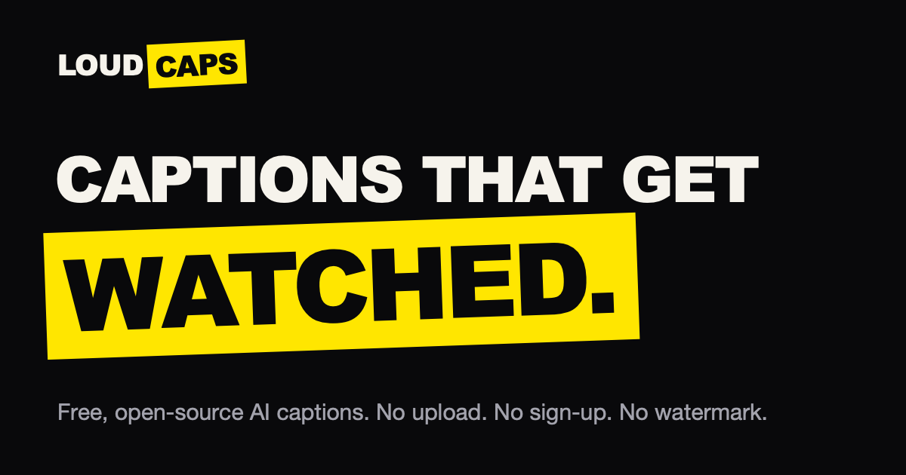

# LoudCaps

**Free, open-source AI captions for short-form video. Runs entirely in the browser.**

Drop in a video, get animated word-by-word captions, export an MP4. No upload, no sign-up, no watermark. Speech recognition and video rendering both happen on your own device.

Created by [AbayAtazhan](https://github.com/AbayAtazhan).

[Open LoudCaps in your browser](https://abayatazhan.github.io/loudcaps-open/)



## What it does

- **Word-level captions** from OpenAI's open Whisper models, with automatic language detection (50+ languages).
- **18 animated caption styles.** One renderer draws both the live preview and the export.
- **A real caption editor**: fix words, split and join captions, highlight keywords, set emoji, nudge sync, undo and redo.
- **Local draft recovery.** The last single-video draft and its source video are stored in this browser. Use **New** to delete the draft.
- **Reframing** to 9:16, 4:5, 1:1 or 16:9 with a crop or a blurred background.
- **Editing effects** such as jump cuts, automatic zooms and emoji, hook titles, and a progress bar.
- **Batch captioning** with local client presets, vocabulary replacements and transcript review.
- **Export** to H.264/AAC MP4 at up to 4K and 60 fps on compatible devices, plus SRT, VTT and plain-text transcripts.

## Run it locally

```bash
npm ci
npm run dev
```

Open http://localhost:3000 for the site and http://localhost:3000/studio/ for the editor.

| Command | What it does |
| --- | --- |
| `npm run dev` | Development server |
| `npm run build` | Static production build into `./out` |
| `npm run preview` | Serve `./out` locally |
| `npm test` | Unit tests |
| `npm run typecheck` | Type-check |
| `npm run fonts` | Re-copy caption fonts after adding one in `scripts/sync-fonts.mjs` |

LoudCaps builds to plain static files. `public/_headers` (Cloudflare Pages, Netlify) and `vercel.json` (Vercel) set the headers for multithreaded transcription. Settings are listed in `.env.example`.

## Captioning a batch

Choose **Batch** in the studio, then add a folder or select individual videos. Save a client preset using a built-in style or the current studio style and framing. Vocabulary lines such as `logcaps = LoudCaps` replace recognized words while retaining their timings. Review each transcript, then render the queue.

Download the rendered MP4s individually, or save them to a folder when the browser supports direct folder access. The batch queue lasts for the current tab. The browser keeps saved client presets and the latest single-video draft locally.

## Hosting

Serve the `out/` directory from a static web host. Set `NEXT_PUBLIC_BASE_PATH` for a deployment under a subdirectory, and set `NEXT_PUBLIC_SITE_URL` to the full public URL. For branch-based GitHub Pages hosting, publish the generated files to the configured Pages branch and add an empty `.nojekyll` file at its root. Hosts that support the cross-origin isolation headers in `public/_headers` or `vercel.json` can run more than one transcription thread.

## How it works

| Path | Role |
| --- | --- |
| `src/lib/asr/` | Whisper in a Web Worker via Transformers.js (WebAssembly). Splits long audio at quiet moments. |
| `src/lib/media/media.ts` | Reads the file and decodes audio to 16 kHz mono with Mediabunny. |
| `src/lib/captions/` | Document model, word grouping, templates, fonts and the canvas renderer. |
| `src/lib/media/export.ts` | Decodes frames, paints them with captions, encodes H.264/AAC with WebCodecs, muxes MP4. |
| `src/components/studio/` | The editor. |
| `src/lib/batch.ts` | Client presets and vocabulary replacements. |

Desktop Chrome and Edge are the recommended environments. Video import and export depend on the codecs supported by the browser and device. Videos can be up to 10 minutes long. The first run downloads the speech runtime and the selected model (67 to 275 MB for the model), then caches them on the device.

## Licence

LoudCaps source code is licensed under **AGPL-3.0-only**. See [LICENSE](LICENSE). Third-party dependencies and fonts carry their own licences.

Built on [Whisper](https://github.com/openai/whisper) (MIT), [Transformers.js](https://github.com/huggingface/transformers.js) (Apache-2.0), [Mediabunny](https://mediabunny.dev) (MPL-2.0) and open fonts (see `public/fonts/LICENSES.md`).
